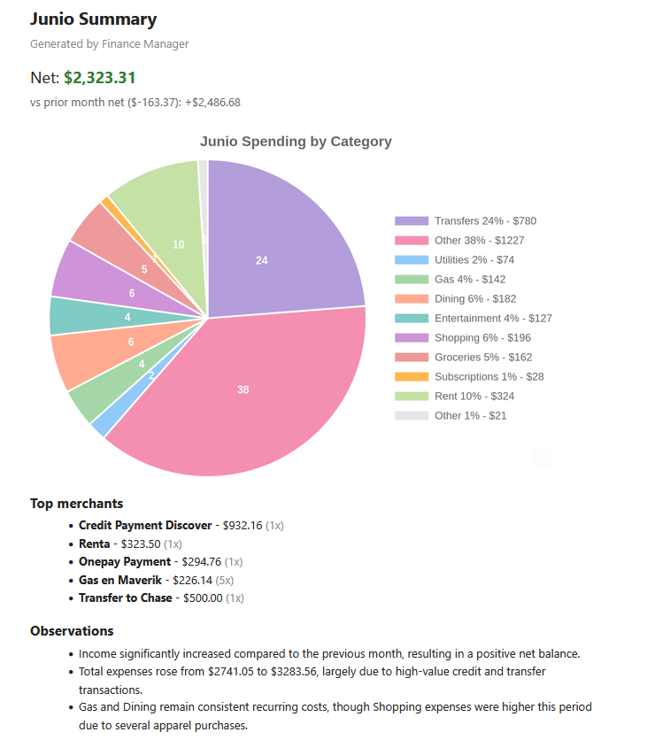

# Finance Manager

The pipeline keeps Google Sheets as the place to edit your finances. Optional
transaction identity tracking protects imported rows from duplicate retries, and
a read-only viewer presents the same Sheet data on a simpler screen.
See [safe rollout and offline tests](docs/safe-rollout.md).

Personal production runs are hosted in a separate private repository. This public repository runs tests with example configuration only. See [deployment privacy](docs/deployment-privacy.md) before connecting real accounts.

## Public code and private execution

| Repository | Responsibility |
| --- | --- |
| Public FinMan-Tab | Python pipeline, bank-linking helpers, viewer, example configuration, and tests |
| Private runner | Scheduled workflow, exact public source version, encrypted sync state, and deployment instructions |
| Private Actions Secrets | Plaid credentials, Google authorization, personal routing configuration, and the state encryption key |

The runner checks out the public source at a pinned commit into an ephemeral
`app/` directory. It restores credentials and cursors, runs the pipeline, persists
encrypted progress, and removes temporary credential files. It does not maintain
a separate copy of the application with personal changes mixed into its code.
Pushing public code does not deploy it automatically: the runner's source `ref`
must change. The Sheet feeds the viewer; editing the viewer never changes Plaid.

A Python pipeline that pulls bank transactions through **Plaid**, cleans the merchant descriptions through **Google Gemini Flash** (in your own voice via few-shot prompting), and writes them into the right table of the right tab in **your own Google Sheet**. At the start of every month it sends you an HTML email summary of the prior month with an LLM-generated commentary and a category breakdown pie chart. Runs unattended through the private runner’s GitHub Actions schedule.

Built around an existing personal-finance spreadsheet rather than replacing it: month tabs, structured tables, running balances, and TOTAL formulas all keep working. The pipeline is config-driven and fork-friendly - your account IDs, your tab names, and your prompt examples live in a few YAML files, not in the code.

---

## Demo

<!-- Demo video coming soon -->

### Screenshots

<p align="center">
  
</p>
<p align="center"><sub><b>Pipeline running in GitHub Actions</b> - Mayo tab auto-created, carryover written, 21 transactions cleaned by Gemini and routed to the right tables.</sub></p>

<p align="center">
  
</p>
<p align="center"><sub><b>Monthly financial summary email</b> - Category breakdown, top merchants, and observations generated from the month's transactions.</sub></p>

<p align="center">
  <sub><i>Mayo tab in Google Sheets - placeholder, screenshot coming soon</i></sub>
</p>

---

## Features

- **Bank ingest via Plaid `/transactions/sync`:** cursor-based incremental updates. The opt-in tracked path handles added, modified, and removed transactions and imports posted entries only. The legacy path handles additions.
- **Spanglish description cleaning via Gemini 3.1 Flash Lite:** few-shot prompted with ~20 of your own real descriptions, so output stays in your voice (`"Walmart - Groceries"`, `"Gas en Chevron"`, `"Paycheck from Student Job"`). Fail-soft - if Gemini is overloaded for a transaction, the raw merchant string lands in the sheet so nothing is ever lost.
- **Date-driven tab routing:** uses `tx.date` (not `today`) so a cron at 12:01 AM on June 1 still files May 30 transactions into Mayo, not Junio.
- **Auto-creates new month tabs from a hidden Template:** duplicates the Template, makes the new tab visible, renames every table inside it to `<prefix><MonthName>` for cleanliness.
- **Configurable balance carryover:** writes a starting-balance row at the top of each new month tab - pulled either from a specific cell in the prior tab (e.g. running balance) or the prior month's table footer (e.g. credit-card total).
- **Monthly summary email:** on the first run of each new month, Gemini analyzes the prior month's transactions and produces a structured summary (net, top merchants, spend-by-category, observations, commentary). An HTML email with an embedded pie chart (via QuickChart.io) lands in your inbox. State persists across runs to avoid repeating completed monthly summaries, with prior-month context fed into Gemini for trend comparisons.
- **Opt-in duplicate protection:** tracked writes commit description, amount, and hidden identity atomically. Retries look up that identity before inserting. Cursors advance after successful bank processing; legacy banks still need reconciliation after partial writes. Manual amount conflicts stop tracked updates for review.
- **Rate-limit handling:** supported Sheets reads and legacy operations use exponential backoff. Tracked mutations deliberately avoid automatic retries after an ambiguous response; the next run checks row identity first.
- **Optional first-sync date filter:** ignore historical transactions on the very first run via `pipeline.start_date` in `config.yaml`. Doesn't affect any future run.
- **No database required:** the sync runs as a Python script. The private runner encrypts its persisted cursors and summary history; the optional viewer runs a separate local web server.

---

## Tech stack

- **Language:** Python 3.10+ (developed on 3.14)
- **Banks:** [Plaid](https://plaid.com/) Production via `plaid-python` (`/transactions/sync` endpoint)
- **LLM:** Google Gemini 3.1 Flash Lite Preview via `google-genai` SDK (free tier, `thinking_budget=0` for speed)
- **Spreadsheet:** Google Sheets API v4 via `google-api-python-client` - uses the structured **Tables** feature so column layouts and TOTAL formulas survive duplication
- **Auth:** Google OAuth user-flow with combined Gmail + Sheets scopes (`google-auth-oauthlib`)
- **Bank linking:** isolated Flask helpers in `onboarding/`; production can also use Plaid Hosted Link with a separate backend exchange
- **Scheduler:** GitHub Actions in the private runner; schedule and usage depend on that deployment

---

## Architecture

```
                                ┌────────────────────┐
                                │   pipeline.py      │
                                │   (orchestrator)   │
                                └─────────┬──────────┘
                                          │
        ┌────────────────────┬────────────┼────────────┬────────────────────┐
        ▼                    ▼            ▼            ▼                    ▼
 ┌──────────────┐    ┌──────────────┐  ┌─────┐  ┌──────────────┐    ┌──────────────────┐
 │ clients/     │    │ clients/     │  │ ... │  │ clients/     │    │ clients/         │
 │ plaid_client │ tx │ gemini_client│  │     │  │ sheets_writer│    │ insights         │
 │ sync+cursor  │───>│ few-shot     │->│     │->│ tabs/tables/ │    │ monthly summary  │
 │              │    │ + retries    │  │     │  │ carryover    │    │ email + chart    │
 └──────────────┘    └──────────────┘  └─────┘  └──────────────┘    └──────────────────┘
        │                    │                          │                    │
        ▼                    ▼                          ▼                    ▼
 access_tokens.json    prompts.yaml              Google Sheet         Gmail + Gemini +
 (cursor state)        (~20 examples)            (your existing)      summary_state.json
```

Per transaction the orchestrator runs: **fetch → route by `account_id` → clean via Gemini → find/create month tab → find table by prefix → write to first empty row.** The carryover step runs once at tab creation, before any transaction is written. After the bank loop, `maybe_send_monthly_summary` checks state and (when the prior month hasn't been summarized) sends an HTML email summary with an embedded category pie chart.

---

## Local setup

### 1. Prerequisites

- Python 3.10+
- A [Plaid Developer account](https://dashboard.plaid.com/signup) with the required environment and Transactions access
- A [Google Cloud project](https://console.cloud.google.com/) with the **Sheets API** enabled
- A [Gemini API key](https://aistudio.google.com/app/apikey) (free tier)
- An existing Google Sheet you'd like to write into, with at least one tab named `Template` containing the structured Tables you want populated

### 2. Clone and install

```bash
git clone https://github.com/<your-username>/Finance-Manager.git
cd Finance-Manager
python -m venv .venv
source .venv/bin/activate   # or .venv\Scripts\activate on Windows
pip install -r requirements.txt
```

### 3. Configure secrets

Copy the env template and fill in your keys:

```bash
cp .env.example .env
```

Edit `.env`:

```
PLAID_CLIENT_ID=<from Plaid dashboard>
PLAID_PRODUCTION_SECRET=<from Plaid dashboard>
PLAID_SANDBOX_SECRET=<optional, for testing>
GEMINI_API_KEY=<from AI Studio>
```

Place your Google OAuth credentials file (downloaded from Cloud Console) at the project root as `credentials.json`. The first time you run anything that needs Sheets, a browser window will open for the OAuth consent flow and `token.json` will be written for subsequent runs.

### 4. Configure your sheet

```bash
cp config.example.yaml config.yaml
```

Edit `config.yaml`:
- `sheet.spreadsheet_id` - copy from your Sheet's URL
- `sheet.template_tab` - name of the hidden template tab (default: `Template`)
- `tab_strategy.naming` - `spanish` / `english` / `numeric`
- `account_routing` - see step 5
- `balance_carryover` - optional; see "Balance carryover" below

`config.yaml` is **gitignored**, so your spreadsheet ID and routing stay private.

### 5. Connect a new card without resetting existing accounts

Use the isolated helpers in [`onboarding/`](onboarding/) and the
[rollout guide](docs/safe-rollout.md). The older `setup/link_banks.py` writes the
root token file and is not the coordinated onboarding path for an existing
private deployment.

The connection and first import are separate steps:

1. Start Plaid Link (or a Plaid Hosted Link session) with the Transactions product.
   Sign into the bank directly in that flow and select the card.
2. Retrieve the temporary public token after consent, then exchange it on the
   backend for an access token and Item ID. Bank passwords are not stored in Git.
3. Read `/accounts/get` and map the chosen account ID to a unique table prefix,
   such as `Amex_`, for both positive charges and negative credits.
4. Add the two-column table to the hidden Template **and** each existing month
   needed for the first import. Updating Template alone does not alter existing tabs.
5. Preview the import window. Fetch the initial sync pages and import eligible
   posted transactions with hidden row identity; pending entries wait until posted.
6. Save the new cursor only after those writes succeed. Briefly pause the runner
   while merging the new connection, routing, and cursor with its latest private
   state. Preserve all existing banks and summary history.
7. Run read-only validation, then a targeted bank sync with summaries disabled.
   Verify the Sheet and state persistence before relying on scheduled execution.

The isolated helper defaults to Sandbox and writes a separate connection file.
Production consent, table setup, first import, and coordinated runner activation
are explicit steps; linking by itself does not activate scheduled imports.

### 6. Run

```bash
python pipeline.py
```

You should see banks sync one at a time, transactions clean through Gemini, and rows appear in the correct month tab.

---

## Configuration

### `account_routing`

Maps Plaid `account_id` to your bank + sheet table prefixes:

```yaml
account_routing:
  "PLAID_ACCOUNT_ID_HERE":
    bank: "discover"
    income_table_prefix: "Discover_"
    outflow_table_prefix: "Discover_"   # same prefix → single-table mode (sign preserved)

  "PLAID_ACCOUNT_ID_HERE":
    bank: "sofi"
    income_table_prefix: "Sofi_Checkings_"
    outflow_table_prefix: "Gastos_Checkings_"   # different → two-table mode (abs amount)
```

When `income_table_prefix == outflow_table_prefix`, the transaction's sign is preserved (used for credit cards). When they differ, `abs(amount)` is used and the transaction routes to the appropriate table by sign.

### `balance_carryover`

Optional. Writes a starting-balance row at the top of each new month tab on creation:

```yaml
balance_carryover:
  - prefix: "Sofi_Checkings_"
    cell: "J21"                          # explicit cell to read in prior tab
    description: "Cuenta Checkings"

  - prefix: "Discover_"
    description: "{prev_month} Expenses"  # no cell → uses prior table's footer
```

`{prev_month}` is substituted with the prior month's tab name. If `cell` is absent, the prior month's same-prefix table is found and its footer Amount cell is read. Empty list (or omitted key) disables the feature.

### `pipeline`

Bank nicknames must match the keys in the private token configuration.
`track_transaction_ids: true` enables tracking for every bank; migrate existing
rows deliberately before using that broader switch. The read-only matcher in
`onboarding/reconcile.py` separates exact matches from edited or ambiguous rows.
Migrated rows can lock their existing descriptions so later bank updates preserve
your wording. Tracking start dates define the historical window being migrated;
older rows are not silently matched or rewritten.

```yaml
pipeline:
  start_date: "2026-05-01"   # one-time first-sync filter; ignored after cursor is set
  pacing_second: 0.5          # delay between Gemini calls
  max_tx_per_bank: null       # reserved setting; currently not enforced
  tracked_banks: [amex]       # opt in only the new bank; existing banks keep their path
  bank_start_dates:
    amex: "2026-11-01"        # excludes older entries and later historical updates
```

---

## Project structure

```
.
├── pipeline.py             # Orchestrator (entry point)
├── config.py               # Loads config.yaml at import
├── clients/
│   ├── plaid_client.py     # Plaid SDK + token / cursor I/O
│   ├── gemini_client.py    # Gemini wrapper with retries + fail-soft
│   ├── sheets_writer.py    # Tab creation, table rename, carryover, writes
│   ├── sync_changes.py     # Complete change batches; posted-only, oldest-first writes
│   ├── tracked_writer.py   # Atomic row values and hidden transaction identity
│   ├── table_capacity.py   # Grow tables into empty space; preserve totals
│   ├── transaction_kind.py # Conservative bank-data classification
│   ├── google_auth.py      # Shared OAuth helper (Gmail + Sheets scopes)
│   └── insights.py         # Monthly summary: gather, Gemini, chart URL, email
├── onboarding/            # Isolated Link flow and offline routing plan
├── viewer/                # Read-only Flask viewer; synthetic data by default
├── scripts/
│   ├── test_offline.py     # Disposable test copy with network disabled
│   └── sheets_acceptance_probe.py # Synthetic live-validation transport harness
├── setup/
│   ├── link_banks.py       # One-time Flask page for Plaid Link
│   ├── inspect_accounts.py # Dumps account IDs per linked bank
│   └── hello_*.py          # Historical API smoke tests
├── tests/
│   ├── test_routing.py             # route_transaction sign handling
│   ├── test_sheets_helpers.py      # _col_letter, _prev_month_name, prefix gathering
│   ├── test_sheets_throttle.py     # read-quota A/B + backoff retry against a fake Sheets service
│   └── test_insights.py            # summary state + categorize + email body + chart URL
├── .github/workflows/
│   └── pr.yml              # Public tests using example configuration
├── prompts.yaml            # Gemini prompt templates + few-shot examples (cleaner + summary)
├── config.example.yaml     # Config template for forks
├── .env.example            # Env-var template for forks
├── requirements.txt
├── LICENSE
└── README.md
```

`config.yaml`, `.env`, `credentials.json`, `token.json`, `access_tokens.json`, `accounts.json`, and `summary_state.json` are all gitignored - secrets and personal IDs never get committed.

---

## Sheets viewer

Preview the viewer without credentials or real transactions:

```bash
python -m viewer.app
```

Open `http://127.0.0.1:8765`. Demo data is labeled as a sample. The viewer provides
month/account filters, search, and transaction lists; editing remains in Sheets.

For live mode, copy `viewer/sheet-config.example.json` to a private local config,
set your spreadsheet ID, explicit tab-to-year/month mapping, and table prefixes.
Share the workbook with a service account as **Viewer**, then run:

```bash
python -m viewer.app --sheet-config viewer/sheet.local.json \
  --readonly-credentials viewer/readonly-credentials.json
```

The live adapter reads descriptions and amounts from Sheets and dates/types from
hidden row metadata. Payments and transfers are excluded from classified spending.
Unknown rows remain visible for review; totals are partial until those rows are
classified. Historical bank rows are not silently guessed or deduplicated.

The server binds to localhost and rejects untrusted Host headers. A private
hosting deployment must deliberately configure its own trusted hostnames. A home-screen manifest is included, but it does
not provide phone connectivity, secure hosting, or a native widget by itself.
Private remote access and automatic startup require separate deployment work.

## Running tests

The Gemini SDK is pinned to `2.34.0`, and the shared cleaner/summary client
explicitly selects `v1beta`. Keep both choices deliberate: the runner previously
installed SDK 3.0.0 automatically, switched to `v1`, and received 404s for the
configured preview model. A synthetic live cleaner check with the pinned SDK
returned a generated description without calling Sheets, Plaid, or email.

```bash
python scripts/test_offline.py
```

The runner uses a disposable copy with synthetic configuration, a dummy Gemini
key, and blocked network connections. It avoids replacing your root config or
advancing production cursors. The current suite has **97 tests**, covering routing,
summary behavior, tracked retry recovery, conflicts, ordering, table growth,
classification, onboarding isolation, and viewer rendering/data reads.

Live write acceptance checks belong in a separate synthetic workbook. See
[validation evidence](docs/live-sheet-validation.md) for what those checks prove
and what remains outside their scope. A successful access check alone does not
prove real transaction processing.

---

## Roadmap and known limitations

**Currently shipped:**
- Plaid → Gemini → Sheets pipeline runs end-to-end and is verified live in production
- Cursor-based incremental sync after successful bank processing
- Month-tab auto-creation with table rename + balance carryover
- Monthly summary email with category breakdown pie chart, structured Gemini output, and trend comparisons against prior-month history
- Private GitHub Actions scheduling; the workflow cron is authoritative and uses UTC
- Private deployment preserves cursors and summary history in encrypted storage; credentials are never cached
- Opt-in tracked writes preserve identity and manual description edits, handle bank changes, and grow standard SUM-total tables into empty space
- Read-only Sheets viewer, isolated onboarding helpers, and 97 offline tests

**Potential future work:**
- Historical reconciliation and broader tracking migration for existing bank rows
- Secure phone access and persistent viewer hosting
- Batch all of a run's writes into a single Sheets call to cut the write count further
- Cross-year carryover automation

**Limitations to be aware of:**
- Gemini Free Tier has 30 RPM and 500 RPD limits. Typical daily volume uses far less than that, but a heavy backfill could hit the per-minute cap.
- The Sheets API has a 60-requests-per-minute-per-user quota. The pipeline keeps reads to ~2 per transaction and retries with backoff on a 429, which comfortably covers personal volumes (<100 tx/day); a very large backfill in one run would still benefit from batching the writes.
- The first call to Plaid `/transactions/sync` for a brand-new Item sometimes returns `added=[]` while Plaid does its background pull. Re-run after a minute and it catches up.
- Cross-year carryover (Diciembre 2026 → Enero 2027) requires manually filling the January carryover row by hand the first time, since each year's transactions live in a separate spreadsheet.
- Scheduled imports are not instant updates. Posting delays and runner timing affect when a transaction reaches the Sheet.
- Oldest-first applies within each fetched batch. Late historical arrivals do not trigger a global re-sort of existing rows.
- Tracked metadata is row-attached with a stored column offset. Sorting just one card’s cells or moving tables can separate values from identity; coordinated moves must include metadata.
- Table growth stops for occupied adjacent cells, overlapping tables/merges, custom total formulas, or insufficient worksheet rows. It does not overwrite those contents.

---

## License

Released under the [MIT License](LICENSE).

---

## Contact

**Adrian Ninanya**

* **GitHub:** [NinyaDev](https://github.com/NinyaDev)
* **LinkedIn:** [Adrian Ninanya](https://www.linkedin.com/in/adrian-ninanya/)
